# Design audit and redesign report (brief 2)

Work log first (kept current so a crash loses nothing); the final report follows at the end.

## Progress log

- 28 Oct, start of session 3. Verified brief-2 "already done" items: 41 outputs lint clean; platform-sizes.md
  exists; `youtube_community` gone; space metrics present.
- Item 1 (planted_space): already fires. `node pipeline/qa/lint.mjs pipeline/qa/fixtures/planted_space.svg` reports
  6 `space` issues (chart share, left margin, unequal margins, two empty bands, single-label gutter).
  planted.svg still 7 under the editorial theme. Added as a fourth check in CLAUDE.md.
- Plan: templates in `pipeline/render/templates/`, shared kit `_kit.js`; charts become short spec files;
  story alternatives as sketches rendered to the scratchpad.
- Built: `pipeline/render/kit.js` (house marks, axes, labels, number formatter, encoding asserts, label
  placement, `firstFit` responsive forms) and templates `lines`, `beeswarm`, `bridge`, `ranked_dots`
  (+ dumbbell), `slope`, `small_multiples`, `calendar`, `waffle` in `pipeline/render/templates/`.
  render.mjs gained `--dir` and `--out`; it now loads every tidy CSV.
- build_tidy.py: new tables cpi_general.csv (published headline for every month, incl. the 2018-19 housing gap),
  cpi_subgroup_yoy.csv, cpi_weights.csv; state_cpi.csv gains Dec 2024; new facts for contribution changes,
  weights, ONI per year at the latest season and per-year peaks.
- Story verdicts (comparison sheets in the scratchpad, copied to briefs/img later):
  CPI -> bridge wins (lead); stacked bars kept as the four-year history; lines lost (four lines tangle).
  El Niño -> beeswarm wins (lead); envelope band replaces the spaghetti as the trajectory view; ridgeline archived.
  States -> ranked dots win where 33 rows fit, beeswarm otherwise (one chart, `firstFit`); map and tiles kept for geography.
- Losers archived in archive/2026-10-28-story-alternatives/sketches/.
- Now: lint round 1 on 12 charts x 9 formats.
- Lint rounds 1-7: fixed in the system, not per chart: label knockouts (kit) and z-order-aware strike/straddle
  checks (lint); bridge drops its value axis and puts totals inside their bars; beeswarm turns vertical on stacked
  canvases and fits its range to the dot size; waffle and calendar fill their box (cells up to 1.35:1 / 2.6:1) and
  right-align in side layouts; small multiples pick the biggest panels; leaders may not cut through labels
  (`Kit.place` accept hook); story headlines capped at 2 lines (formats.json). New lint `style` check.
  Shape-following charts (beeswarm) are marked `data-fill="shape"`: lint skips the area minimum and in-chart
  bands for them (gaps in a distribution are data, not wasted layout); margins and outer bands still apply.
- Copy changes forced by the claim checks: cpi_timeline wanted "first time below 2% since the target"; June 2017
  (1.46%) was. Now "under 2% in five of the last six months", with the 'first' verified in code and stated in the dek.

---

# Report (28 Oct 2026, session 3)

All four checks pass at the end (commands under "Checks" below): 95 outputs (11 charts × 9 formats, minus
4 honest `LAYOUT` skips: state_tiles in square, story, blog_wide and web) lint clean, including the new `style`
check. (104 with the map, before it was withdrawn; see decision 4.)

## 1. The stories, rethought

Method: wrote each story's one sentence, sketched two to four forms on the new templates, rendered every
form in all nine formats into the scratchpad, compared side by side against the current chart, picked on
clarity first, elegance second. Images: `briefs/2026-10-28-design-audit-img/`.

### CPI contributions: food pulls inflation down, personal care (gold, silver) holds it up

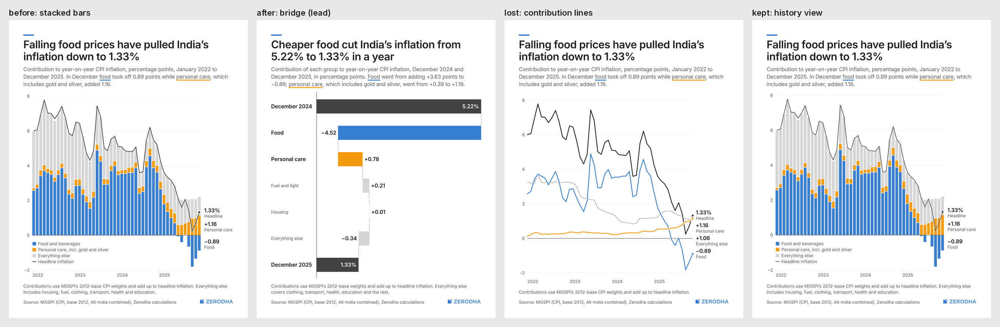

| Tried | Verdict |
|---|---|
| Stacked bars, Jan 2022 to Dec 2025 (current) | Accurate, but the reader must find the last three bars and decode a stack to see the point. **Kept as the history view** (`cpi_contrib`), where the four-year path matters (blog, YouTube). |
| **Bridge, Dec 2024 to Dec 2025** (`cpi_bridge`) | **Wins.** One look: 5.22% at the top, food takes off 4.52 points, personal care adds 0.78, 1.33% at the bottom. Both halves of the story in one chart, every bar carries its number, no axis needed. Works in all nine formats. |
| Contributions as lines | Food diving below zero is vivid, but four lines over four years tangle on a phone. Lost. |

### El Niño: 2026 is the strongest on record this early in the year

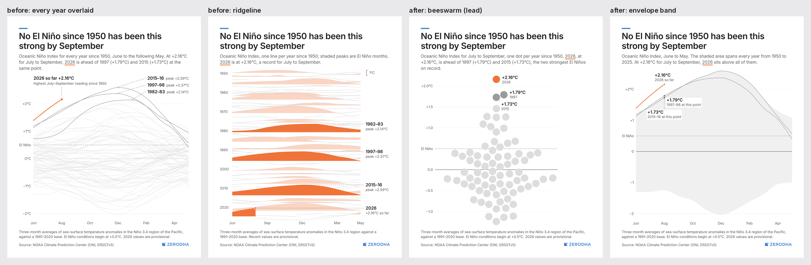

| Tried | Verdict |
|---|---|
| 77 overlaid years (`oni_lines`, current) | Accurate but busy; "on record" needs reading three labels. Archived. |
| Ridgeline (current alternative) | Stylised; peaks read as flat bands, and the record is not visible at a glance. Archived. |
| **Beeswarm of every year at July–September** (`oni_swarm`) | **Wins.** "On record" becomes one orange dot alone at the top (vertical on phone canvases, horizontal beside a header column). 1997 and 2015 named next to it. |
| **2026 against the envelope of 1950–2025** (`oni_band`) | Second chart: the trajectory, "this early in the year", is the orange line leaving the grey range. Replaces the spaghetti. |

### State inflation: Kerala is rising seven times as fast as India

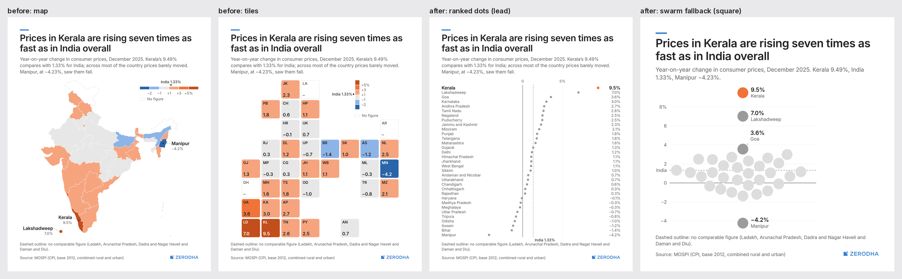

| Tried | Verdict |
|---|---|
| Map (current) | Shows where, not how far. Kerala's 9.49% and Goa's 3.56% are two shades apart. Kept as the geography view, still **not publishable** (boundary unverified). |
| Tile grid (current) | Every value visible, but comparing numbers across a grid is slow. Kept for geography where it fits (5 formats). |
| **Ranked dots against an India line** (`state_ranked`) | **Wins** where 33 rows fit (portrait, blog): every state named, Kerala's distance from India is the picture. |
| Beeswarm | Wins where rows do not fit (square, story, web, landscape): the same chart file falls back to it via `firstFit`, extremes named. |
| Dumbbell, Dec 2024 to Dec 2025 | A different story (change, not level), and at 33 rows it fit no format. Lost; the dumbbell mode stays in `ranked_dots` for shorter lists. |

Landscape versions of the three leads: `briefs/2026-10-28-design-audit-img/landscape_after.png`.

## 2. House style (now in CLAUDE.md, enforced where marked)

1. One point per chart, stated in the headline; the form is chosen for it (`chart-choice`).
2. Roles, not colours: hero (series colour, 3.5k, white halo, end dot), compare (#9B9B9B, 2k), context
   (#DDDDDD, 1k). At most three highlight hues. **[lint style]**
3. Strokes only from theme `marks`. **[lint style]**
4. The label pair: value 600 ink over name 400 grey, on the data, placed in open space by `Kit.place`,
   dashed leader when not adjacent, white knockout so no gridline runs through words. Legends only as a last resort.
5. Hairline horizontal gridlines only; zero line 1.5k; unit on the top tick only; domains hug the data.
6. Reference lines and bands labelled in the axis column, like ticks.
7. One number formatter, true minus sign **[lint style]**; numbers from facts by key **[lint numbers]**.
8. Space: the chart fills its box, no single-label gutters, no dead bands **[lint space]**; forms adapt per canvas.
9. Every template asserts its own encoding.

## 3. The library (`pipeline/render/templates/`, shared `kit.js`)

| Template | Job | Example chart (real data) | Encoding assertion |
|---|---|---|---|
| `lines` | change over time; envelope, target band, callouts | `oni_band`, `cpi_timeline` | each series' drawn extent vs data extent; colour by role |
| `beeswarm` | one among many | `oni_swarm`, `state_ranked` (fallback) | dot position on the value axis; colour by role |
| `bridge` | decomposing a change | `cpi_bridge` | bar ends and widths; steps must add to the end total |
| `ranked_dots` (+ dumbbell) | ranking against a reference | `state_ranked` | dot x; descending order; colour by role |
| `slope` | two dates, who swapped | `cpi_slope` (food groups and personal care) | both line ends; colour |
| `small_multiples` | many series, each with its own story | `cpi_groups` (8 CPI groups, 2014–2025) | each panel's line extent on the shared scale |
| `calendar` | whole history plus season, against bins | `cpi_calendar` (RBI 2–6% band) | each cell's bin colour; highlighted cell must exist |
| `waffle` | part to whole, countable | `cpi_basket` (CPI weights) | squares per part = largest-remainder counts; total 100 |

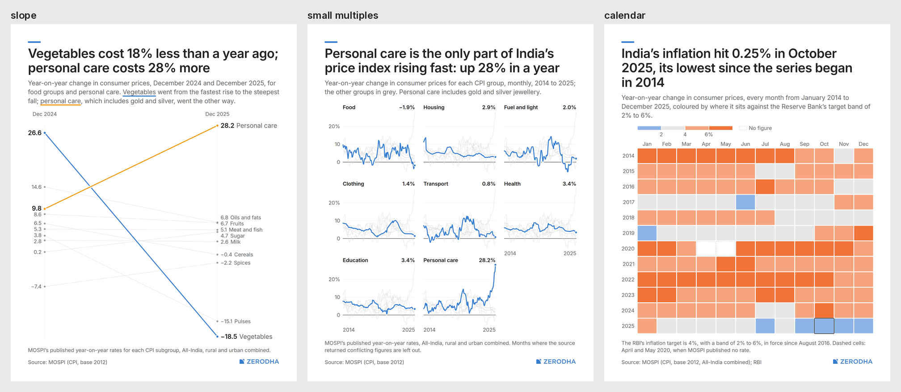
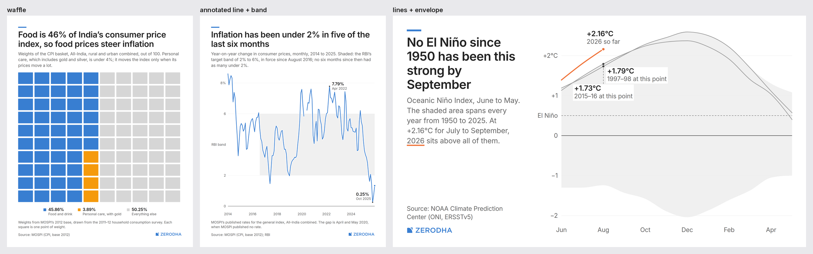

Every chart's copy re-checks its claim in code (`COPY:` errors): record season, "seven times", lowest month,
"five of the last six months, a first", "only personal care is rising fast", the slope's swing.
New data built for them in `build_tidy.py` (with checks): published headline for every month, subgroup rates,
weights, contribution changes, per-year ONI facts, December 2024 state rates.

Skipped forms, on purpose: bump chart (no ranking-over-time data yet that would be honest), annotated event
timeline (event dates would be uncheckable text; the `lines` callouts cover data-driven annotation).

## 4. Skills (`.claude/skills/`)

- `chart-choice`: job-to-form table mapped to the library, the five-second test, what won in our own tests,
  when not to chart, small multiples, `firstFit`, never-list, and what a new template must ship with.
- `chart-copy`: headline/dek/notes/source/labels/alt text rules, good/bad pairs from Indian finance and economy,
  length limits per format, a seven-point self-check.
- `chart-stats`: base effects, index ratios, contributions and weights, CAGR, points vs per cent, real vs nominal,
  per capita, start dates, records, small samples, multiple comparisons, causation, revisions, survivorship and
  look-ahead, seasonality, gaps and conflicts, truncated axes, log scales, rounding; each with an Indian example
  and the pipeline check.

## 5. Brief 1 leftovers

- `planted_space.svg`: fires 6 `space` issues (it already did; the fixture comment now says 6). Added as a
  fourth required check. `planted.svg` stays at exactly 7 under the editorial theme. Planted-defect count: 7 + 6.

## 6. What is still weak

- Beeswarm labels for close neighbours (1997 at +1.79, 2015 at +1.73) sit close together; legible, not elegant.
- The `data-fill="shape"` lint exemption is a judgement: a beeswarm's empty corners are the distribution's shape.
  It skips only the area minimum and in-chart bands; margins and outer bands still apply.
- Ranked dots need 33 rows × 1.1 lines: only portrait and blog fit; elsewhere the swarm names four states, not 33.
- `cpi_contrib` and `state_map`/`state_tiles` predate the kit: they meet the house style by lint, but are not
  yet rebuilt on templates.
- Lint takes about four minutes for 104 files; fine now, slow once the library grows.
- The calendar's diverging bins reuse the map ramp; for inflation the cool side (under 2%) is "below target",
  which is a judgement the legend states only through the RBI note.

## 7. Decisions (owner delegated them: "You're in charge. You take the calls.")

1. **Leads confirmed:** `cpi_bridge`, `oni_swarm`, `state_ranked` are the primary charts; `cpi_contrib`, `oni_band`,
   `state_tiles` are the secondaries. `oni_lines` and `oni_ridgeline` stay archived. Reason: each lead won the
   five-second test against the old chart (section 1).
2. **Story headlines capped at 2 lines** (`formats.json` story `max_lines.headline`). Reason: three 56px lines took
   a fifth of the usable height on a canvas whose safe zones already take a third. Charts carry a short variant.
3. **Beeswarm exemption kept** (`data-fill="shape"`). Reason: forcing a distribution to fill a box means fat dots
   and a heavier look, against the house style's "thin, precise". The exemption is narrow (area minimum and
   in-chart bands only) and visible in every SVG.
4. **Map withdrawn from output.** `state_map.js` moved to `pipeline/render/sketches/`; its outputs and caption were
   deleted from `output/`, so it cannot be posted by accident. It returns to `charts/` only with a boundary file
   checked against the Survey of India political map. The publishable geography view is `state_tiles`.
   Who sources that file is still open; it is not something this pipeline can verify.
5. **Waffle cells are square again.** The template now picks a 10x10, 20x5 or 5x20 grid, beside or above its labels,
   whichever gives the biggest square cells without leaving an empty band (removes item 1 of "still weak").
6. No brand deviations needed; `_deviations` unchanged.

## Checks (all pass)

```
node pipeline/qa/lint.mjs output/zerodha/*/*.svg                                  # all clean (95 files; state_map withdrawn)
node pipeline/qa/lint.mjs --theme=editorial pipeline/qa/fixtures/planted.svg      # exactly 7 issues
node pipeline/qa/lint.mjs pipeline/qa/fixtures/planted_space.svg                  # exactly 6 space issues
node pipeline/qa/lint.mjs archive/2026-10-27-stack-bakeoff/outputs/editorial/cpi_contrib.svg  # fails brand
```

---

# Brief 3: fix list and visual grammar (session 4)

## Progress log (session 4)

- 28 Oct, start. Read briefs 1–3 and this report. Looked at the current PNGs of the three leads in
  instagram_portrait and x_landscape, and the two library sheets. Snapshot of every output and the pipeline
  source taken to the scratchpad as "before".
- Plan: grammar tokens first (theme `grammar`, read by tokens.mjs, kit and frame), because most fix-list
  items are instances of a missing rule (minimum mark, ink levels, tick coverage, label lanes, note devices,
  section gaps). Then the fix list on top of it, then lint checks with planted defects, then the beauty pass.
- Grammar tokens written: theme `type` (roles with step, weight, colour), `grammar.ink`, `grammar.space`
  (2xs 2 … 3xl 48), `grammar.gaps`, `grammar.mark` (bar_ratio 0.5, min_mark 4, swarm_dot_max 14, leader_min 16…),
  `grammar.axis` (covering ticks), `grammar.devices`. tokens.mjs maps roles to format sizes by `step`.
  Kit gained `K.sp/K.gap/K.ink/K.mk`, `K.ticks` (covering ticks), `K.refLine`, `K.bar` (minimum mark),
  `K.annotate` (sentence annotations placed in open space), `K.lane` (label lanes). Frame: role colours,
  dek now #424242, chart text tabular, notes fill the side column, side headlines capped at 3 lines.
- Fix list done in templates: bridge (pale totals, minimum mark, half-row bars, step notes as annotations),
  beeswarm (14k max dots, context as hairline rings, label lane with visible leaders), ranked_dots (value
  column dropped, ends + hero labelled, covering ticks, India named in the axis row), state notes per chart,
  slope (hero labelled both ends, context unlabelled and named once, full width), small multiples (shared
  covering scale, per-panel clip, compare-weight line, key in the spare cell), calendar (grey = inside band).
- Copy: short side-layout headline variants for oni_*, cpi_bridge, cpi_groups, cpi_calendar, cpi_contrib.
- Lint: new `grammar` check in lint.mjs and a source check `qa/lint_code.mjs`; planted defects
  `fixtures/planted_grammar.svg` (6 grammar issues, built by `fixtures/plant_grammar.py`) and
  `fixtures/planted_code.js` (5 issues). First full lint found 281 grammar issues (tile codes and India marker
  off-role, black default fills on lines, the contrib headline line in #222, knockouts measured without tabular
  figures); all fixed in the system. Rendered to output/: 96 files, all clean.

---

# Report (28 Oct 2026, session 4: brief 3)

All checks pass (list at the end). 96 outputs lint clean (11 charts × 9 formats minus three honest
`LAYOUT` skips: state_tiles in square, blog_wide and web; it now fits story).

## 1. Fix list, before and after

Images: `2026-10-28-design-audit-img/refine3_*.png` (top row before, bottom row after; portrait and X landscape).

| Item | Before | After, and where the fix lives |
|---|---|---|
| Bridge: Housing +0.01 invisible | 0.4px bar; row read as empty | `K.bar` never draws thinner than `grammar.mark.min_mark` (4k), centred on the true position; a light-grey sliver takes compare grey so it shows. The encoding assertion knows the rule. |
| Bridge: heavy bars | Two #424242 totals, 62%-of-row slabs | Totals in `ink.total` #E3E3E3 with ink values inside; bars `mark.bar_ratio` 0.5 of the row, capped at `bar_max`. Only food and personal care carry colour. |
| Bridge: empty area right of the food bar (portrait); gap in the left column and 4-line headline (landscape) | Dek carried the food and gold numbers; column half empty | Step notes are now annotations placed in the open space (`K.annotate`, slots beside the value or under the bar, else nearby with a leader, else dropped). The dek shrank to what is measured. Side layouts set notes in the header column (`frame.js`), and side headlines are capped at 3 lines with short variants. |
| Swarm: big grey discs | r up to 34k, solid #DDDDDD | Dots at most `mark.swarm_dot_max` (18k), swarm at most half the spread axis; context dots are hairline rings in compare grey, peers filled grey, the hero filled orange. |
| Swarm: 1997/2015 labels cramped, stub leaders | `Kit.place` per label, leaders 3px long | Label lane (`K.lane`): blocks spread in value order, set one leader_min past the furthest nearby dot, so every leader is at least 16k and visible. `K.leader` refuses stubs shorter than `leader_min`. |
| States: note named a dashed outline that is not drawn | Map copy reused | Chart-specific notes (`S.textLeftOut` for charts that omit missing states). New render-time `COPY:` check and lint `grammar` check: a device word (dashed, outline, shaded, hatched) needs a mark tagged `data-device`. |
| States: "India 1.33%" sitting on the note | Label drawn below the last row, outside the plot | The reference is named in the axis row like a tick (centred, or hung either side of its line to clear tick labels). Lint `grammar` now checks header, chart and footer are at least `section_min` (12k) apart; the planted fixture reproduces the bug. |
| States: value column repeated the dots | 33 values in a right column | Column dropped. Values beside the dots for the hero and the two ends (`showValues: "ends"`), on knockouts. |
| States: axis only 0 and 5% | d3 ticks filtered to two | `K.ticks`: round steps that cover the data (no end more than half a step past the outer tick), 3 label-heights apart, domain stretched to the next round tick when that costs at most `axis.stretch_max`. Lint checks coverage on every `data-axis`. Now −5, 0, 5, 10%. |
| Slope: unlabelled left values, cramped right stack, empty middle band | Every line labelled at the right, values only at the left | Hero lines labelled at both ends with the label pair, in lanes; context lines unlabelled and named once ("Other food groups"); the two date axes use the full width. |
| Small multiples: lines escaping panels, jittery hero, empty ninth cell | Unclipped, 3.5k hero, spare cell blank | Shared scale stretched to a round top tick (gridline caps every panel), each panel clipped, hero at compare weight (2k), panel width must fit its header; a spare cell carries a key (`spec.key`) and a grid with spare cells is chosen only when there is one. |
| Calendar: 4–6% in warning orange | Bins 2/4/6 | Bins 2/6/8: grey inside the RBI band, blue below, orange above, darker past 8%. Legend says "Grey: inside the RBI's 2–6% band". |

## 2. The visual grammar (theme `grammar` and `type`; kit `K.*`)

**Type roles** (`type.*`; size by `step` from the format; lint `grammar` checks every text):

| Role | Step | Weight | Colour | Used for |
|---|---|---|---|---|
| `headline` | headline | 600 | #222222 | headline |
| `dek` | body | 400 | #424242 | dek (was #666666) |
| `label_strong` | body | 600 | #222222 | hero names, panel titles, totals |
| `value` | body | 600 | #222222 | numbers on the data (tabular) |
| `label` | small | 400 | #666666 | names, reference names, context values |
| `label_on_fill` | small | 600 | #222222 / white | codes inside tiles |
| `axis` | small | 400 | #666666 | tick labels (tabular) |
| `annotation` | small | 400 | #424242 | sentences written into the chart |
| `note`, `source` | small | 400 | #666666 | footer |

White replaces a role's colour only on a dark fill. All text inside `g.chart` uses tabular figures (frame CSS;
`textWidth` measures them the same way); header and footer prose keeps proportional figures.

**Ink** (`grammar.ink`, `K.ink`), loudest first: hero = series colour; `compare` #9B9B9B; `total` #E3E3E3;
`context` #DDDDDD (lines, light bars), `context_fill` #E8E8E8; `reference` #9B9B9B dashed; `baseline` and
`leader` #424242; `grid` #EDEDED; `band` #F3F3F3. Nothing else may colour a chart mark (lint `grammar`;
binned ramps marked `data-ramp` excepted).

**Highlight**: the series colour plus a strong label; everything else in the same quiet grey and unlabelled
(named once as a group if it needs a name). Same in bridge, swarm, ranked dots, slope, lines, small multiples.

**Annotation**: one leader (dashed, `leader` ink, 1k, never shorter than `mark.leader_min`); one label
anatomy (value in `value`, name in `label` beneath, on a knockout the colour of what it sits on); labels
for many points go in a lane (`K.lane`); sentences use `K.annotate` (open space, within six leader_mins of
the mark, or dropped); reference lines (`K.refLine`) are dashed reference grey and named in the axis
column or axis row like a tick.

**Spacing** (`grammar.space`, `K.sp`): `2xs` 2, `xs` 4, `s` 8, `m` 12, `l` 16, `xl` 24, `2xl` 32,
`3xl` 48 (×k). Named uses in `grammar.gaps` (`label_mark` s, `value_name` xs, `leader_clear` xs,
`axis_label` m, `panel_x` 2xl, `panel_y` xl, `column` 3xl, `section_min` m) and `header.gaps` (topper l,
headline m, dek-to-chart l, chart-to-footer xl). `qa/lint_code.mjs` fails any `N * k` or hex literal in
kit, frame and templates.

**Marks** (`grammar.mark`, `K.mk`): `bar_ratio` 0.5, `bar_max` 44, `min_mark` 4, `corner` 0,
`cell_corner` 2, `cell_gap` 3, `dot` 5, `dot_hero` 6, `dot_small` 3.5, `swarm_dot_max` 18,
`swarm_dot_min` 4, `leader_min` 16; strokes stay in `marks` (hero 3.5, compare 2, context/grid/leader 1,
baseline 1.5).

**Grid and axes** (`grammar.axis`, `K.ticks`): horizontal hairlines only; ticks `label_gap` (3)
label-heights apart, `ticks_min` 2 to `ticks_max` 6, covering the data; unit on the last tick; axis labels
only in the first column of small multiples; direct labels before legends.

**Composition**: one left edge for topper, headline, dek, chart labels, notes and source; header,
chart and footer at least `section_min` apart; the plot stays clear of the logo's clear space; side
layouts give the header column 30%, cap the headline at 3 lines and put notes in the column (they drop out
when a legend needs the room), so the column has no dead gap.

**Devices** (`grammar.devices`): copy may name dashed, outline, shaded, hatched only when a mark carries
`data-device`; checked at render (COPY error) and by lint.

## 3. Leads, before and after (portrait and X landscape)

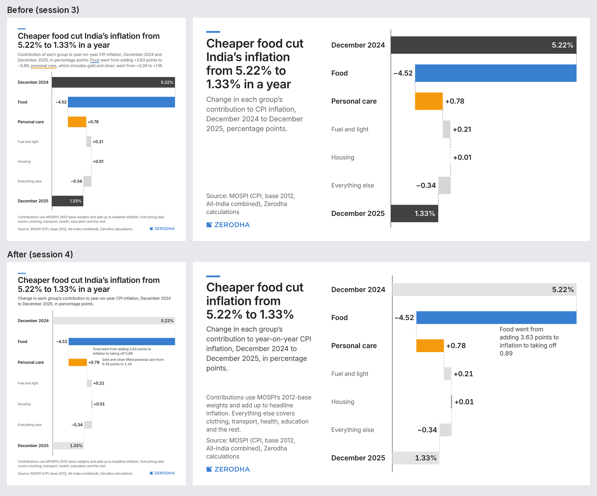
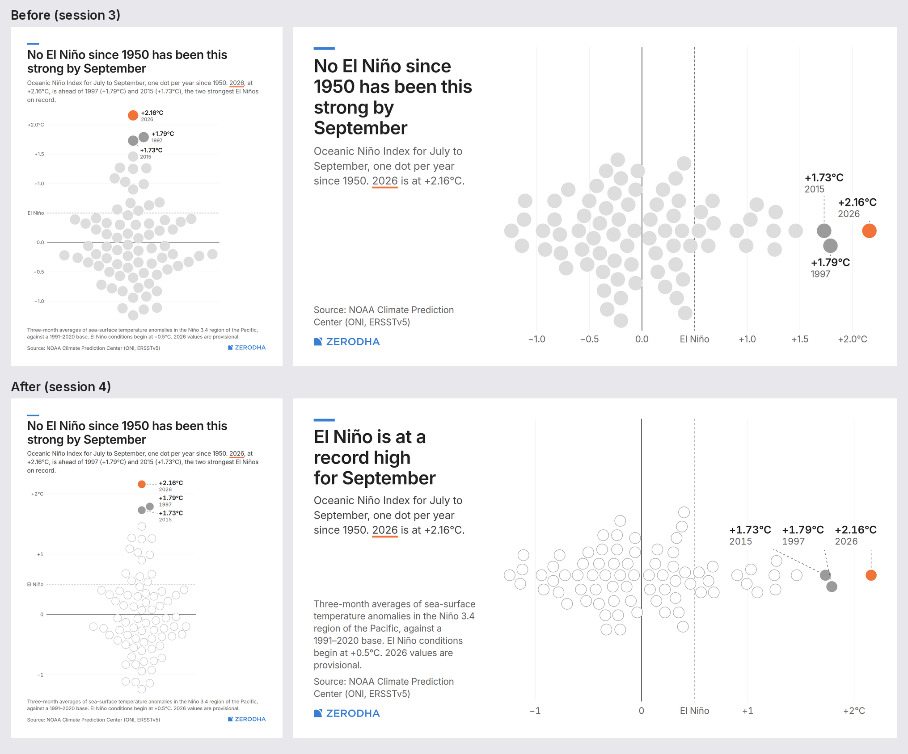
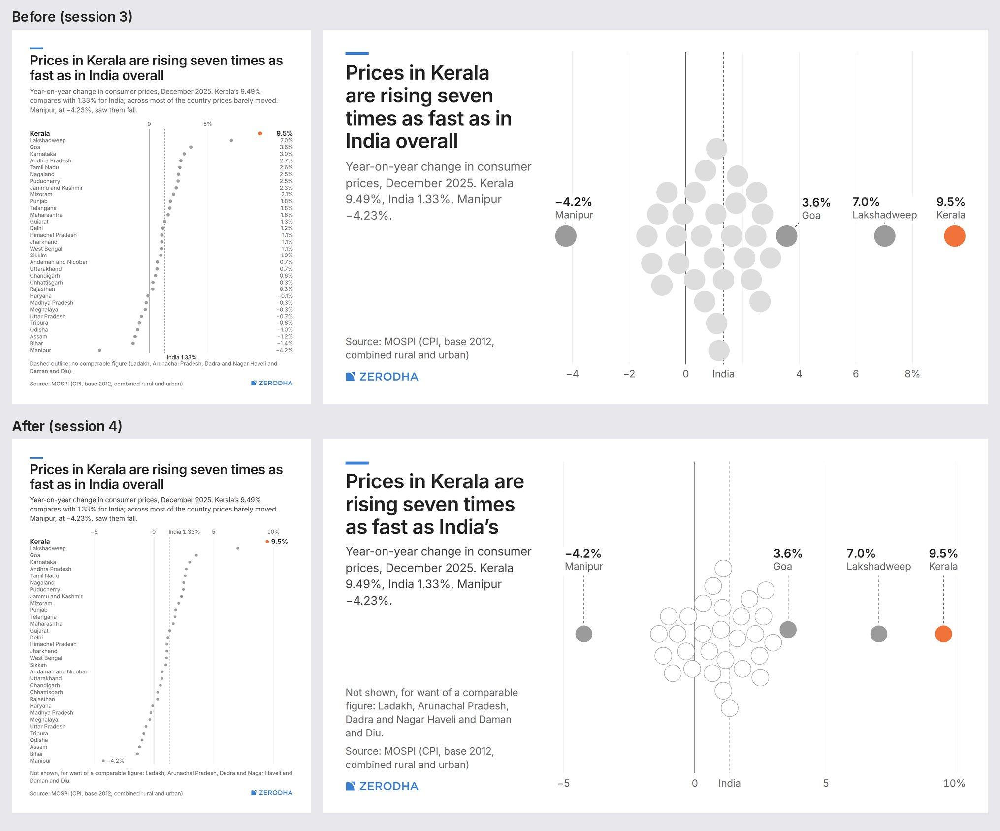
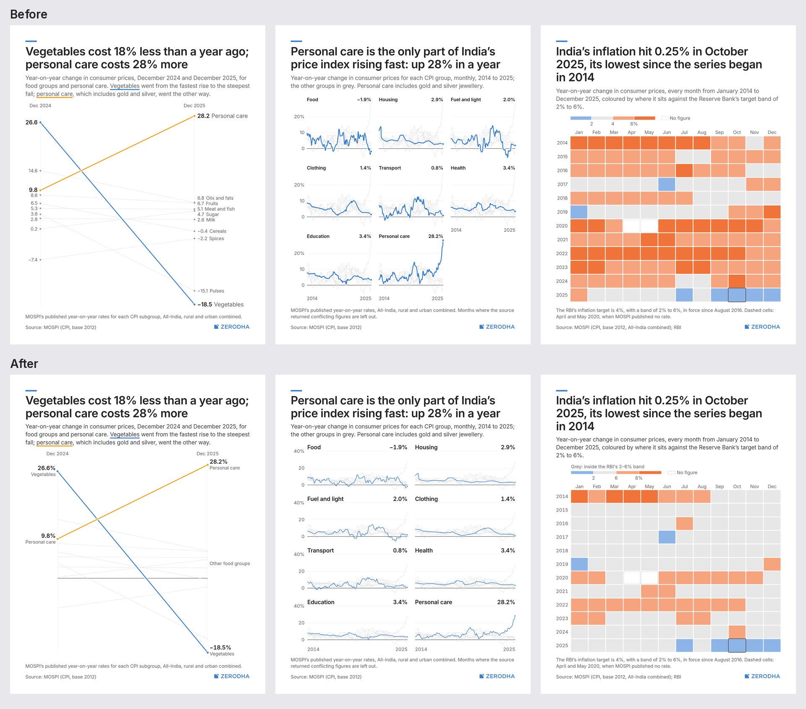
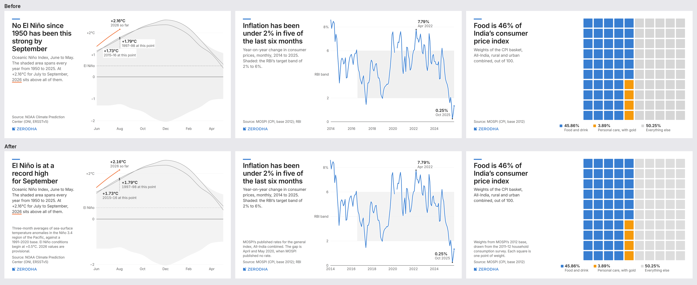

Beauty pass, beyond the fix list: dek one shade darker (#424242) so it reads as text, not caption;
lighter gridlines and reference lines; envelope labels in oni_band sit on band-coloured knockouts instead
of white stickers; swarm gridlines run from the axis labels to the swarm; trajectory domain hugs the data
(little stretch at the top); waffle picks the arrangement with the least slack; chart-to-footer gap
tightened to `xl`.

## 4. Checks (all pass)

```
node pipeline/qa/lint.mjs output/zerodha/*/*.svg                                  # all clean (96 files)
node pipeline/qa/lint.mjs --theme=editorial pipeline/qa/fixtures/planted.svg      # exactly 7 issues
node pipeline/qa/lint.mjs pipeline/qa/fixtures/planted_space.svg                  # exactly 6 space issues
node pipeline/qa/lint.mjs archive/2026-10-27-stack-bakeoff/outputs/editorial/cpi_contrib.svg  # fails brand
node pipeline/qa/lint.mjs pipeline/qa/fixtures/planted_grammar.svg                # exactly 6 grammar issues
node pipeline/qa/lint_code.mjs                                                     # 0 issues
node pipeline/qa/lint_code.mjs pipeline/qa/fixtures/planted_code.js               # exactly 5 issues
```
(planted_space's dek was recoloured to the new dek role, so it still fires only its 6 space issues.)

## 5. What is still weak

- `cpi_contrib` and `state_tiles` are still hand-built chart files, not templates. They pass the
  grammar lint (inks and roles were brought into line), but their internals still use `N * k`
  constants (lint_code only covers kit, frame and templates).
- Horizontal swarms in wide side layouts are a thin band in a tall box; the dots are capped at 18k on
  purpose, so there is air above and below. Correct, but less striking than the portrait version.
- Bridge notes are dropped when they do not fit near their bar (x_landscape loses the personal care
  note). The chart still reads, but the gold story is then only in the bar.
- Small multiples in portrait now use 2×4 (the panel header must fit), so the key cell appears only in
  square and wider formats.
- The type-role check matches size, weight and colour, not intent: a name set in the `value` role would
  pass. Roles are enforced by the kit's fonts, not by tagging every text.
- The `section_min` check measures only vertical separation (stacked sections, and the side header column).
- The full lint run takes about five minutes for 96 files.

---

# Final pass: proportions and the last two charts (session 4, continued)

## Progress log

- Request relayed from the parent session (owner-approved): bridge rows sized to content, swarm filling its
  box (and a check for it), state axis outlier handled honestly, cpi_contrib and state_tiles on templates,
  lint under 90 seconds. Starting with lint speed.
- Lint parallelised (one browser, a page per file, 10 at a time): full run 71 s, was about 5 min. Fixtures unchanged.
- Bridge: turns to columns when a row would be taller than `grammar.mark.row_max` (portrait, blog); rows stay
  in landscape, square, story and web. New lint `space` metric `bar_fill` (bar thickness over slot pitch,
  min 0.4): the brief-3 portrait bridge scores 0.35 and fails; the new one passes in every format.
- Swarm: fitted to its box (dot size, then looser spacing up to 2.5× diameter) to fill 62–78% of the room
  beside the label lane. New lint `space` metric `swarm_cross` (min 0.45 of the plot's cross axis): the
  brief-3 portrait swarm scores 0.42 and fails (`fixtures/planted_swarm.svg`, exactly 1 space issue).
- States: axis kept linear (Kerala's distance is the claim; a break or squeeze would hide it). The crowded
  strip is explained by a checked note beside it: "25 of 33 states and union territories are within two
  points of India" (count computed in the chart, COPY error if it stops being a majority).
- cpi_contrib rebuilt on a new `stacked_bars` template (covering ticks, seams from the spacing scale, total
  line in baseline ink, direct end labels for every series instead of a legend). state_tiles rebuilt on a new
  `tiles` template; the binned legend moved into the kit (`K.binLegend`) and the map sketch uses it too.
  lint_code now covers chart files as well (0 issues in 26 files). state_tiles now fits square and web
  (98 outputs; only blog_wide skips it).

## Report: final pass

Images (top: brief 3; bottom: now; portrait and X landscape):
`2026-10-28-design-audit-img/final_cpi_bridge.png`, `final_oni_swarm.png`, `final_state_ranked.png`,
and the two rebuilt charts in `final_rebuilt.png`.

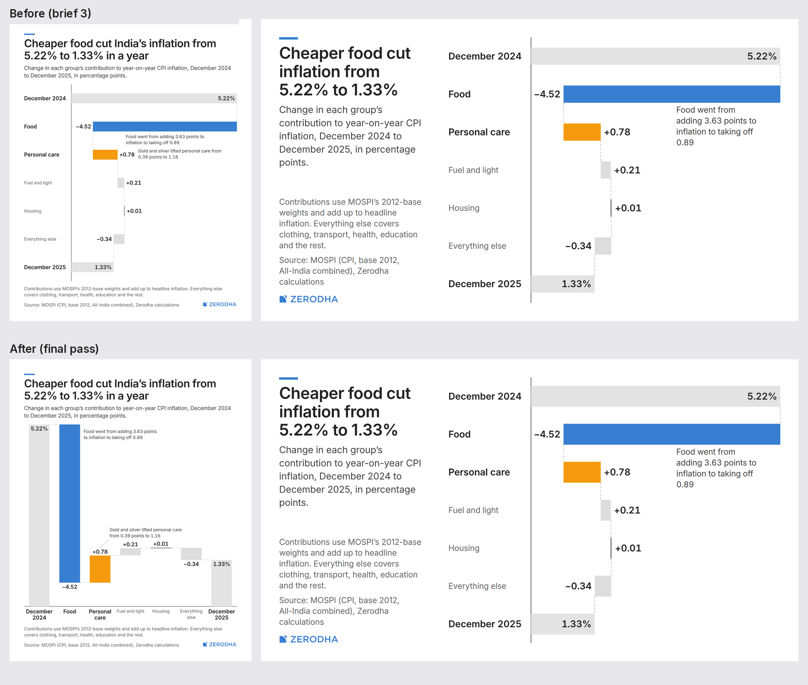
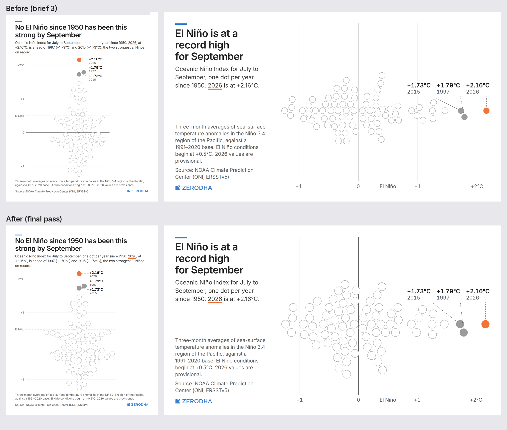
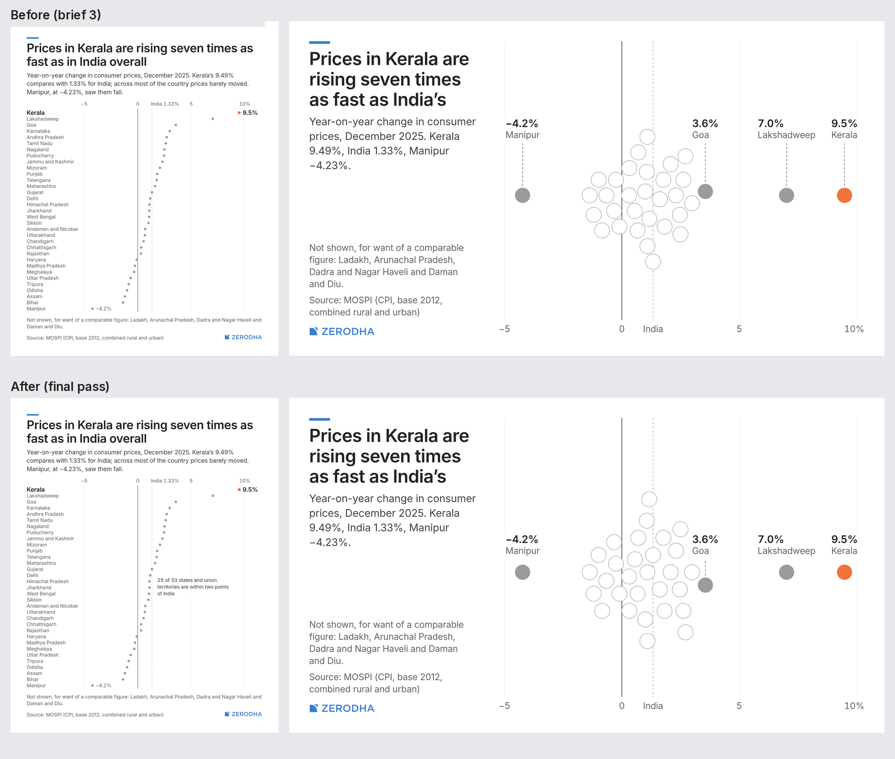
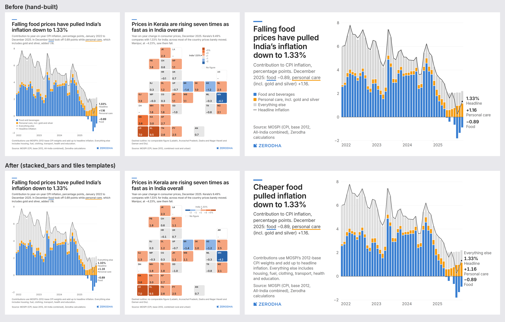

| Item | Fix (in the system) | Check |
|---|---|---|
| 1. Bridge mostly air | Orientation follows the box: rows while a row ≤ `mark.row_max` (100k), columns on taller plots (portrait, blog), with bars `bar_ratio` of the slot. Columns put values above rises and below falls, names under, notes in the open upper right. | New `space` metric `bar_fill` ≥ 0.4: brief-3 portrait scored 0.35 (fails); now passes everywhere. |
| 2. Swarm too thin | Dot size within `swarm_dot_min..max`, then looser spacing (up to `swarm_gap_max_ratio` 2.5 × diameter) to fill `swarm_fill_lo..hi` (62–78%) of the room beside the label lane. | New `space` metric `swarm_cross` ≥ 0.45 of the plot's cross axis; `fixtures/planted_swarm.svg` (the brief-3 portrait, 0.42) fires exactly 1 space issue. Now 0.46–0.64 across formats. |
| 3. States axis | Kept linear. The headline is Kerala's distance from India; a broken or squeezed axis would shrink exactly that, so the empty right half is honest. The crowding is explained beside the strip: "25 of 33 states and union territories are within two points of India" (counted in code; COPY error if it stops being a majority). Kerala's value stays labelled. No change to the encoding rule, so the assertion needed none. | Annotations now carry knockouts (lint caught a gridline through the note). |
| 4. Old charts | `stacked_bars` and `tiles` templates; `K.binLegend`; chart files covered by `lint_code`. | 0 issues in 26 files. |
| 5. Lint speed | One browser, a page per file, up to 10 at once (`LINT_JOBS` overrides). | 98 files in 68 s (was about 5 min); every fixture count unchanged. |

All checks pass:
```
node pipeline/qa/lint.mjs output/zerodha/*/*.svg                                  # 0 issues, 98 files, 68 s
node pipeline/qa/lint.mjs --theme=editorial pipeline/qa/fixtures/planted.svg      # exactly 7 issues
node pipeline/qa/lint.mjs pipeline/qa/fixtures/planted_space.svg                  # exactly 6 space issues
node pipeline/qa/lint.mjs archive/2026-10-27-stack-bakeoff/outputs/editorial/cpi_contrib.svg  # fails brand (64)
node pipeline/qa/lint.mjs pipeline/qa/fixtures/planted_grammar.svg                # exactly 6 grammar issues
node pipeline/qa/lint.mjs pipeline/qa/fixtures/planted_swarm.svg                  # exactly 1 space issue
node pipeline/qa/lint_code.mjs                                                     # 0 issues (kit, frame, templates, charts)
node pipeline/qa/lint_code.mjs pipeline/qa/fixtures/planted_code.js               # exactly 5 issues
```

### Still weak

- Portrait swarm changed least: it already filled 53% of the plot width, so the fit left it as it was. It
  is still a tall, narrow shape with the label lane on its right. That is honest for 77 years over a
  3°C range, but it is not as full as the landscape version.
- The bridge in columns puts all seven names under the axis at body/small size; in the web format (rows)
  and story (rows) it is unchanged. Story stays in rows because its safe zones leave a short plot.
- Loosened swarm spacing (up to 2.5 × diameter) makes landscape swarms airier than a tight beeswarm; density
  still reads, but outliers look less isolated than in a tight pack.
- The states note is an extra sentence on an already busy portrait; on canvases without room it is dropped
  rather than squeezed.
- state_tiles still does not fit blog_wide (tiles 54px, need 85px).
- The map sketch is not covered by lint_code (sketches are unpublished alternatives).

## Report: refinement pass 4 (29 Oct)

The owner asked for more beauty and firmer opinions, naming the Kerala dot chart. I reviewed every chart in
portrait and X landscape, fixed what the system allowed, and recorded each fix as a rule.

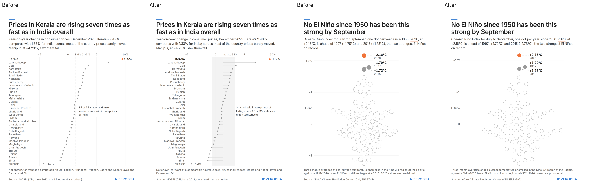
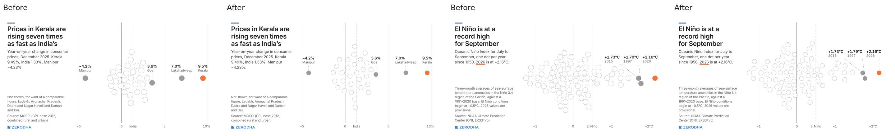
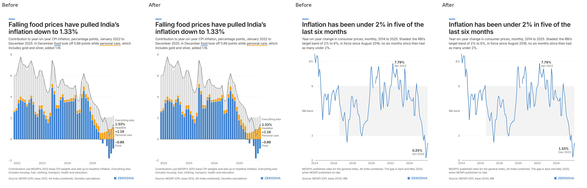

| Chart | Fault | Fix (in the system) |
|---|---|---|
| state_ranked | The heaviest mark was the black zero line, yet the story is distance from India; names sat far from their dots; small grey specks; the note claimed a cluster the chart did not show. | `ranked_dots` gains `stems` (each dot on a stem from the reference, so the reference is the baseline and zero becomes a gridline) and `band` (shaded, `data-device="shaded"`). Kerala is a long orange stem; the ±2-point band shows the crowd, and the note now names it ("Shaded: within two points of India, where 25 of 33 … sit", still counted in code). Names are right-aligned against the plot. Notes stay clear of the band, so their white knockout never cuts the shading. A new assertion recomputes both ends of every stem. |
| oni_swarm (tall) | The label lane reserved a full-width strip, but the labels sit beside the swarm's narrow tip, so about 260 of 1080px stayed blank. | `beeswarm` now fits the swarm to the whole box first and reserves a lane only if a label then has no room. Portrait swarm: 37% → 55% of canvas width. |
| all swarms | Big discs (18k) with spacing loosened up to 2.5× looked like bubbles or polka dots. | `swarm_dot_max` 18 → 15, `swarm_gap_max_ratio` 2.5 → 1.6: smaller marks, still one shape. Every swarm still spans ≥ 45% (lint). |
| cpi_contrib | "Everything else" (a name with no value) sat directly above "1.33% Headline" and read as its name. | `stacked_bars`: a name-only end label gets a margin of `sp("m")` in the lane. |
| cpi_timeline | The month the headline's "last six months" end on had no label. | End label on the latest month (1.33%, Dec 2025, from facts by key); the October low label is now optional and drops where the two collide. |

Checks: all pass (98 outputs 0 issues in 55 s; fixtures 7 / 6 space / brand fail / 6 grammar / 1 space;
lint_code 0 in 26 files; planted_code 5).

### Follow-up: the states fallback fixed

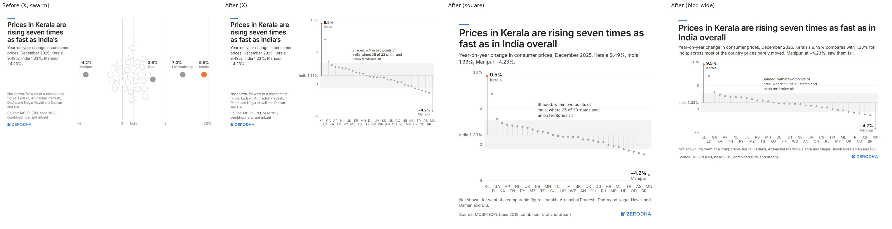

The owner asked to fix the main weakness: state_ranked fell back to a swarm in six formats. Two general rules
in `ranked_dots`:

- **Names step down** (full, then `short`, then `code`) until the list fits in one or two columns. Rows with
  a value label (hero, ends) always keep their full name. States supply short forms Indian readers use
  (J&K, A&N Islands, Himachal, Andhra, MP, UP, Bengal) and the tile codes.
- **On a wide plot where the list would need two columns, the ranking turns on its side**: a column per
  state in rank order, a stem up or down from India's line, the band across, codes under the axis (staggered
  on two rows when a column is narrower than a code), the label pair beside Kerala and Manipur. If that
  does not fit either, the list is drawn. Assertions recompute dot heights, both stem ends, rank order
  left to right, and colours.

Result: every format now shows the stems. Portrait and blog keep the list with full names; X, LinkedIn,
YouTube, story, square, web and blog wide use the columns. The swarm stays as the last fallback but no format
reaches it. Checks: 98 outputs, 0 issues (73 s); all fixture counts unchanged; lint_code 0.

### Still weak

- On the column form, states are identified by two-letter codes (as on the tile chart). Indian readers
  know most; a few (CG, UK, AN) are less obvious. The labelled states are named in full.
- The October 2025 low (0.25%) is no longer labelled on cpi_timeline; the calendar chart carries that fact.
- Manipur's value label sits on its own stem (the knockout clears it, but it is busier than the right end).
- Still open from before: state_tiles does not fit blog_wide.
